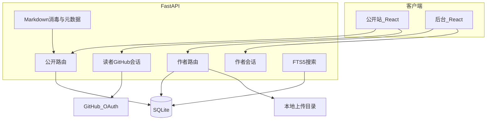
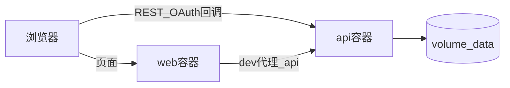

# 架构文档：zw-blog

| 项 | 内容 |
| --- | --- |
| 版本 | v1 |
| 对应 PRD | [01-prd.md](01-prd.md) |
| 对应实现 | [03-technical.md](03-technical.md) |

## 1. 目标与边界

本系统是单作者个人博客：公开阅读在浏览器里完成，写作与删评走后台，读者评论依赖 GitHub OAuth。

v1 物理上只有两个进程（`web`、`api`）和一个 SQLite 文件。不引入 Nginx、Redis、独立数据库容器。

## 2. 逻辑架构



`web` 只负责界面与调用 `/api`。业务规则、鉴权、搜索、文件落盘都在 `api`。

## 3. 进程与容器

| 服务 | 职责 | 对外端口（开发默认） | 持久化 |
| --- | --- | --- | --- |
| `web` | Vite 开发服务器；生产用 `vite preview` 提供静态资源 | 5173 / 4173 | 无 |
| `api` | FastAPI：REST、OAuth 回调、静态上传文件 | 8000 | SQLite volume、`uploads` volume |

没有反向代理。开发时 Vite 把 `/api` 代理到 `http://127.0.0.1:8000`，浏览器只打 `web` 源，避免 CORS 噪音。生产 Compose 中 `web` 通过环境变量 `VITE_API_BASE_URL` 指向 `api` 的可达地址；若同机部署，可用 `http://localhost:8000`。`api` 配置 CORS 白名单，只允许 `web` 的 origin。



## 4. 模块边界

每个模块只通过明确接口协作，禁止 UI 直接读写 SQLite。

| 模块 | 职责 | 依赖 |
| --- | --- | --- |
| `auth_admin` | 校验作者用户名密码，签发/校验作者会话 | 环境变量 |
| `auth_github` | GitHub OAuth 授权码换票，签发读者会话 | GitHub、环境变量 |
| `articles` | 文章 CRUD、发布/撤回、slug 唯一 | `tags`、仓储 |
| `tags` | 标签创建与查询 | 仓储 |
| `search` | 已发布文章全文检索 | FTS5 |
| `comments` | 创建/列表/作者删除 | `auth_github`、`articles` |
| `about` | 单页关于我读写 | 仓储 |
| `uploads` | 校验并保存图片，返回公开 URL | 本地磁盘 |
| `web-public` | 列表、详情、标签、搜索、关于、评论 UI | `api` 公开接口 |
| `web-admin` | 登录、编辑器、关于我编辑 | `api` 作者接口 |

仓储接口按「可替换」编写（函数或小型 repository），v1 实现为 SQLite。迁 PostgreSQL 时只换仓储与连接配置，不改路由签名。

## 5. 身份与会话

系统里有两套互不相通的身份。

| 身份 | 如何获得 | 凭证形态 | 能调用 |
| --- | --- | --- | --- |
| 作者 | `POST /api/auth/admin/login` | HttpOnly Cookie，例如 `admin_session` | `/api/admin/**`、删评 |
| 读者 | GitHub OAuth 成功回调 | HttpOnly Cookie，例如 `reader_session` | `POST` 评论、退出读者登录 |
| 匿名 | 无 | 无 | 只读公开接口 |

- 作者凭据来自 `ADMIN_USERNAME` / `ADMIN_PASSWORD`，不建用户表。
- 读者不建账号表。评论行保存 `github_id`、`github_login`、`github_avatar_url`。
- Cookie 使用 `SameSite=Lax`；生产配 `Secure`。密钥为 `SESSION_SECRET`。
- 两枚 Cookie 名称不同，清除其中一个不影响另一个（对应 PRD FR-30 / FR-26）。

未带作者会话访问 `/api/admin/**` 返回 `401`。未带读者会话 `POST` 评论返回 `401`。公开 `GET` 永不要求登录。

## 6. 主要数据流

### 6.1 发布文章

1. 作者登录，获得 `admin_session`。
2. `POST /api/admin/articles` 存草稿。
3. 可选 `POST /api/admin/uploads`，把返回 URL 写入 Markdown。
4. `POST /api/admin/articles/{id}/publish`：校验标题与 slug，写 `published`、`published_at`，更新 FTS5。
5. 公开 `GET /api/articles` 即可读到。

### 6.2 读者评论

1. 读者在文章页点「使用 GitHub 登录」。
2. 浏览器进入 `GET /api/auth/github`，api 重定向到 GitHub。
3. GitHub 回调 `GET /api/auth/github/callback`，api 换 token、读 user、写 `reader_session`，再 302 回原文。
4. `POST /api/articles/{slug}/comments` 校验会话与正文，插入后立刻出现在 `GET` 评论列表。

### 6.3 搜索

1. 读者提交关键词。
2. `GET /api/articles?q=` 只查 FTS5 中已发布文档。
3. 空 `q` 时接口按「忽略搜索、走普通列表」或 `400` 处理，以技术文档为准；UI 侧空词不发搜索请求（FR-16）。

## 7. 数据存储决策

**v1 使用 SQLite。**

| 考虑 | 结论 |
| --- | --- |
| 规模 | 个人站点，文章与评论量远低于 SQLite 舒适区 |
| 运维 | 单文件，备份即拷贝；Compose 只挂 volume |
| 搜索 | FTS5 覆盖标题 + 正文，不必上独立搜索引擎 |
| 并发 | 单 `api` 进程、写操作少（作者一人），WAL 足够 |

**何时迁 PostgreSQL：** 需要多实例 `api` 同时写同一库，或单文件备份/体积变得不可接受。届时更换仓储实现与连接串，表结构保持关系型语义不变。

不使用 Redis：会话放签名 Cookie（服务端可不存 session 表）；无热缓存需求。

## 8. 部署视图

开发：

```text
本机 Node（Vite） ──proxy /api──► 本机 uvicorn
                                   └── data/blog.db
                                   └── data/uploads/
```

生产（Docker Compose，无 Nginx）：

```text
web  容器：构建后的前端 + vite preview
api  容器：uvicorn
volume：./data 或 named volume → /data/blog.db 与 /data/uploads
```

健康检查：`GET /api/health` 返回 `{ "status": "ok" }`。

## 9. 安全要点

- 密钥只在 api 进程环境中：`ADMIN_PASSWORD`、`SESSION_SECRET`、`GITHUB_CLIENT_SECRET`。
- 公开查询一律 `status = published`。
- 评论按纯文本存储并转义输出；Markdown 渲染用消毒库，见技术文档。
- 上传按 MIME + 扩展名双检，不执行用户文件。
- OAuth `state` 参数防 CSRF；回调 URL 必须与 GitHub App 配置一致。
- 登录失败统一 `401` + 通用文案（FR-28）。

## 10. 错误处理与可观测性

- api 使用统一 JSON 错误体：`{ "error": { "code", "message" } }`。
- v1 日志打到 stdout，Docker 收集即可。不做独立 APM。
- 前端对 401/404/422 展示中文说明，不弹原始堆栈。

## 11. 测试策略（架构级）

| 层 | 工具 | 覆盖 |
| --- | --- | --- |
| api | pytest + httpx | 文章状态机、搜索、鉴权、评论、OAuth 用 mock |
| web | Vitest + Testing Library | 关键页渲染与表单 |
| 验收 | 浏览器手工或 Playwright（可选） | 发布闭环、GitHub 登录（可在预发环境） |

每个 GitHub Issue 关闭前必须有对应自动化测试通过记录。

## 12. 演进

- SEO 不足时：公开页可迁 Next.js，**api 合同保持不变**。
- 换库：只替换仓储与 Docker 服务，不改 React。
- 以后若加 Nginx，仅作为可选边缘层，v1 验收不依赖它。
